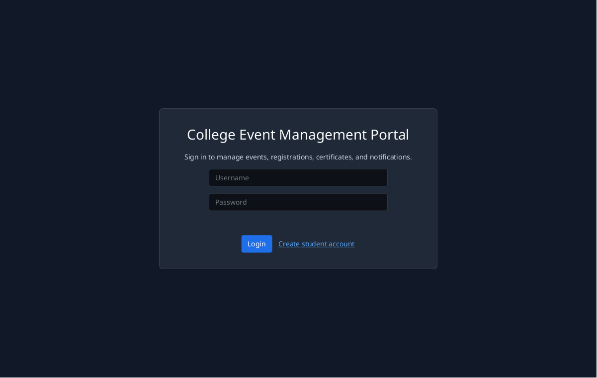
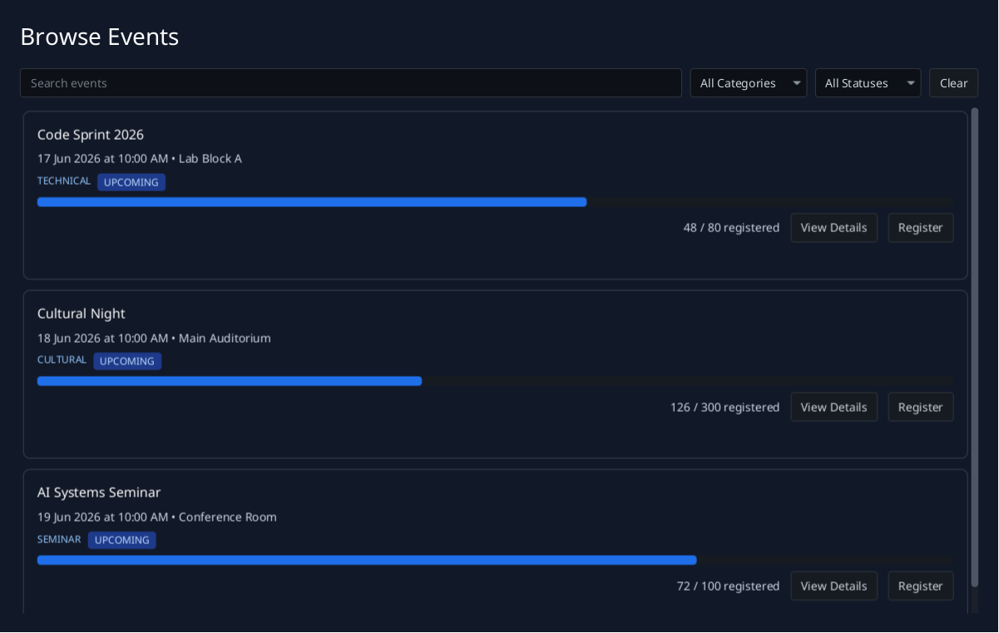

# College Event Management Portal

A JavaFX desktop application for managing college events, student registrations,
PDF certificates, analytics, and notifications with PostgreSQL persistence.





## Features

### Students

- Create an account and sign in with BCrypt-secured credentials.
- Browse events with keyword, category, and status filters.
- View event details, organizer information, capacity, date, time, and venue.
- Register for available events and cancel active registrations.
- Track registration codes and event status.
- Generate, preview, open, and save PDF certificates for completed events.
- Read notifications and mark one or all notifications as read.
- View registration, certificate, and unread-notification dashboard totals.

### Administrators

- Create, edit, start, complete, cancel, and safely delete events.
- Inspect registered students for an event.
- Send duplicate-safe reminders to active registrants.
- View event, registration, and student totals.
- Review category distribution, monthly registrations, and popular events.
- Open a text-based reporting view for the same operational data.

## Technology

| Area | Technology |
|------|------------|
| Desktop UI | JavaFX 21, AtlantaFX |
| Language | Java 17 compatible; CI uses JDK 21 |
| Persistence | PostgreSQL 16, JDBC, HikariCP |
| Security | BCrypt, prepared statements, role checks, bounded input validation |
| PDF | Apache PDFBox |
| Build | Maven 3.9, Maven Shade, JaCoCo |
| Local infrastructure | Docker Compose, pgAdmin |
| Automation | GitHub Actions, GHCR |

## Quick Start

### Prerequisites

- JDK 17 or newer
- Docker Engine or Docker Desktop with Compose
- Maven 3.9+, or the included `./mvnw` bootstrapper
- `xvfb` only when running JavaFX tests on headless Linux

### Run locally

```bash
cp .env.example .env
make dev-up
make app-run
```

The JavaFX application runs on the host and connects to PostgreSQL in Docker.
pgAdmin is available at `http://localhost:5050`.

Default development credentials:

| Account | Username | Password |
|---------|----------|----------|
| Portal administrator | `admin` | `admin123` |
| Sample student | `student1` | `admin123` |
| Sample student | `student2` | `admin123` |
| pgAdmin | `admin@admin.com` | `admin` |

These are local seed credentials. Change all defaults before using the project
outside an isolated development environment.

## Configuration

Copy `.env.example` to `.env` and override values as needed:

| Variable | Purpose | Default |
|----------|---------|---------|
| `POSTGRES_DB` | Development database name | `event_portal_db` |
| `POSTGRES_USER` | PostgreSQL user | `postgres` |
| `POSTGRES_PASSWORD` | PostgreSQL password | `postgres123` |
| `POSTGRES_PORT` | Host PostgreSQL port | `5432` |
| `PGADMIN_EMAIL` | pgAdmin login email | `admin@admin.com` |
| `PGADMIN_PASSWORD` | pgAdmin login password | `admin` |
| `APP_DB_URL` | JDBC URL used by the desktop app | `jdbc:postgresql://localhost:5432/event_portal_db` |
| `APP_DB_USER` | JDBC username | `postgres` |
| `APP_DB_PASSWORD` | JDBC password | `postgres123` |
| `APP_CERTIFICATES_DIR` | Constrained PDF certificate directory | `certificates` |

Runtime environment variables override `src/main/resources/config.properties`.
Secrets must not be committed.

## Commands

```bash
make help          # List commands
make dev-up        # Start PostgreSQL and pgAdmin
make dev-down      # Stop local services
make db-reset      # Recreate database volumes and seed data
make app-run       # Run the JavaFX desktop application
make test          # Run tests
make verify        # Test, enforce coverage, and package
make screenshots   # Regenerate README images from JavaFX
make app-build     # Build the regular JAR
make app-jar       # Build the distributable fat JAR
make docker-build  # Build the CI/artifact container image
```

`make test` and `make verify` automatically use `xvfb-run` on headless Linux
when it is installed and `DISPLAY` is not set.

## Architecture

```text
JavaFX views
    |
    v
Controllers / business rules
    |
    v
DAO interfaces implemented with prepared JDBC statements
    |
    v
Bounded HikariCP pool
    |
    v
PostgreSQL
```

- Views collect input and render state; slow database, BCrypt, and PDF work runs
  through background JavaFX tasks.
- Controllers enforce authentication, authorization, validation, lifecycle, and
  ownership rules.
- DAOs own SQL and transactions. All external values are bound parameters.
- Models are immutable records with constructor invariants.
- `NavigationManager` owns scene changes and back navigation.
- PDF generation and file access are isolated behind controller/utility
  boundaries and confined to the configured certificate directory.

High-level and low-level design documents are maintained under `docs/design/`.
Run `scripts/design-check.sh` to validate their required sections.

## Database

Schema and seed scripts live in `sql/`. The repeatable sample dataset includes
five events, two students, two confirmed registrations, and matching
notifications.

| Table | Purpose | Important relationships |
|-------|---------|-------------------------|
| `users` | Admin and student identities | Referenced by events, registrations, notifications |
| `events` | Event details, lifecycle, and capacity | Created by a user; owns registrations and optional notifications |
| `registrations` | Student participation and registration codes | Links one user to one event |
| `certificates` | Generated PDF metadata | One certificate per registration |
| `notifications` | User messages and read status | Belongs to a user; may reference an event |

The schema enforces valid enum values, time ordering, positive capacity,
registered-count bounds, unique active registrations, and duplicate-safe event
reminders.

## Verification

```bash
make verify
docker compose config
docker compose -f docker-compose.test.yml config
scripts/design-check.sh
```

The Maven build runs:

- Unit tests for models, utilities, controllers, and security boundaries
- Live PostgreSQL integration tests for all core DAOs and transactions
- JavaFX construction, interaction, navigation, and application-bootstrap tests
- Real PDF generation and preview tests
- A JaCoCo bundle line-coverage gate of at least 80%
- Regular and shaded JAR packaging

The coverage report is written to `target/site/jacoco/index.html`. The
distributable artifact is `target/college-event-portal-all.jar`.

## CI/CD

- `ci.yml`: PostgreSQL-backed tests, JavaFX tests under Xvfb, coverage, package,
  and artifact uploads on pushes and pull requests.
- `docker-build.yml`: Buildx image build and GHCR push on `main`.
- `release.yml`: Tagged release build, SHA-256 checksum, GHCR image, and GitHub
  Release attachment for tags matching `v*.*.*`.

The Docker image is intended for repeatable build/artifact workflows. The
interactive JavaFX GUI should run on a desktop host with a display.

## Project Layout

```text
src/main/java/com/eventportal/
  controller/   Business workflows and authorization
  dao/          PostgreSQL data access and transactions
  model/        Immutable domain records and enums
  util/         Configuration, validation, navigation, PDF, and async helpers
  view/         Programmatic JavaFX screens

src/test/java/com/eventportal/
  controller/   Controller contract tests
  dao/          Live PostgreSQL integration tests
  model/        Domain invariant tests
  util/         Utility and PDF tests
  view/         JavaFX screen and interaction tests

sql/            Schema and repeatable seed data
screenshots/    Reproducible documentation screenshots
```

## Security Notes

- Passwords are hashed with BCrypt and limited to its safe input size.
- User and event input is validated against database lengths before persistence.
- Every SQL input uses a prepared statement.
- Certificate reads reject traversal and symbolic-link escapes.
- Runtime database credentials come from environment configuration.
- The runtime container uses a dedicated non-root account.

## Contributing

See `CONTRIBUTING.md`. Use conventional commits and run `make verify` before
opening a pull request.

## License

Licensed under the MIT License. See `LICENSE`.
