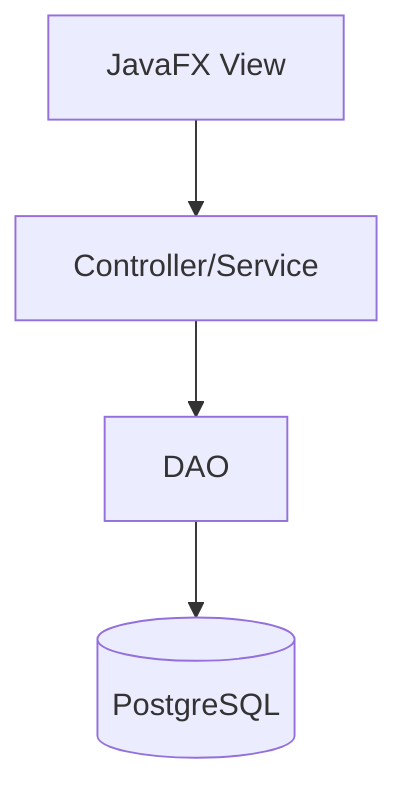

# High Level Design: College Event Management Portal

## Context

- Problem: Manage college events, registrations, certificates, analytics, and notifications in a desktop app.
- Users/Roles: Admin and Student.
- Related plan section: `implementation_plan.md`.

## Goals

- Provide a maintainable JavaFX desktop application with clear layer boundaries.
- Keep PostgreSQL local development Docker-first.
- Support secure authentication, event registration, certificate generation, and dashboards.

## Non-Goals

- Web deployment.
- Running the interactive JavaFX GUI inside Docker.

## Architecture

## Components

| Component | Responsibility | Depends On |
|-----------|----------------|------------|
| View | JavaFX screens and user input | Controller |
| Controller | Business rules and orchestration | DAO, Util |
| DAO | JDBC persistence and row mapping | DatabaseConnection |
| Model | Domain data and enums | None |

## Data Flow

1. JavaFX views collect input and call controllers.
2. Controllers validate rules and call DAOs inside required transaction boundaries.
3. DAOs use prepared statements against PostgreSQL and return models to controllers/views.

## Security And Validation

- Inputs validated at: view and controller boundaries.
- SQL safety: prepared statements for all user-supplied values.
- Authentication/authorization: BCrypt passwords, role checks for admin/student workflows.
- Secrets/config: environment variables override local defaults.
- File/path safety: certificate output constrained to configured directory.

## Failure Handling

- User-facing errors: concise validation and operation messages.
- Logged/internal errors: detailed context without secrets.
- Retry or recovery behavior: database connection and long-running UI tasks report failure cleanly.

## Testing Strategy

- Unit tests: validation, controllers, utilities, PDF generation where practical.
- Integration tests: DAO behavior with disposable PostgreSQL.
- Manual checks: JavaFX login, registration, admin event management, certificates, dashboards.

## Open Decisions

- Exact attendance/completion rule for certificate eligibility.
