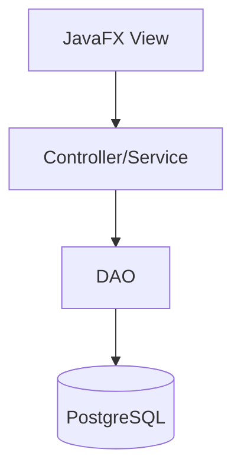

# High Level Design: <Feature Or Module Name>

## Context

- Problem:
- Users/Roles:
- Related plan section:

## Goals

- 

## Non-Goals

- 

## Architecture

## Components

| Component | Responsibility | Depends On |
|-----------|----------------|------------|
| View |  | Controller |
| Controller |  | DAO, Util |
| DAO |  | DatabaseConnection |
| Model |  | None |

## Data Flow

1. 
2. 
3. 

## Security And Validation

- Inputs validated at:
- SQL safety:
- Authentication/authorization:
- Secrets/config:
- File/path safety:

## Failure Handling

- User-facing errors:
- Logged/internal errors:
- Retry or recovery behavior:

## Testing Strategy

- Unit tests:
- Integration tests:
- Manual checks:

## Open Decisions

- 
