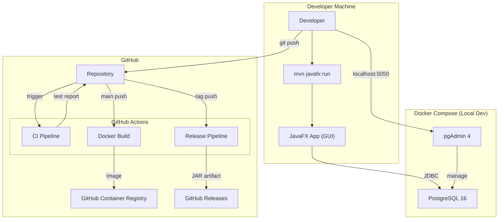

# College Event Management Portal

A full-featured desktop application for managing college events, built with **JavaFX + PostgreSQL + Maven**. The portal supports two roles (Admin/Student), event creation, registration, certificate generation, analytics dashboards, and notifications.

**Fully Dockerized** with local dev setup via Docker Compose, multi-stage build Dockerfile, and CI/CD pipeline via GitHub Actions.

## User Review Required

> [!IMPORTANT]
> **Docker-First Approach**: PostgreSQL runs inside Docker — **no need to install PostgreSQL locally**. You only need Docker Desktop installed.

> [!IMPORTANT]
> **Java Version**: This project targets **Java 17+** with **JavaFX 21**. The CI/CD pipeline builds with JDK 21.

> [!WARNING]
> **PDF Library Choice**: Using **Apache PDFBox** (Apache 2.0 license, free for all use) instead of iText (AGPL — requires open-sourcing your code). PDFBox is simpler and license-friendly for a college project.

> [!IMPORTANT]
> **GitHub Repository Required**: You'll need a GitHub account and a repository created for the CI/CD pipeline to work. I'll provide the complete workflow files.

## Open Questions

> [!NOTE]
> 1. **Do you have Docker Desktop installed?** The local dev setup relies on Docker Compose for PostgreSQL + pgAdmin.
> 2. **Do you have JDK 17+ installed locally?** Needed to run the JavaFX app on your machine (the GUI can't run inside Docker since it needs a display).
> 3. **Do you have a GitHub account?** Needed for the CI/CD pipeline.

---

## Proposed Changes

### Docker & Infrastructure

#### [NEW] docker-compose.yml
Local development stack with:
- **PostgreSQL 16** — Database server on port `5432`, persistent volume for data
- **pgAdmin 4** — Web-based DB management UI on port `5050` (admin@admin.com / admin)
- **Health checks** — PostgreSQL readiness probe before dependent services start
- Shared Docker network `event-portal-net`
- Named volumes: `postgres_data`, `pgadmin_data`

```yaml
# Key services:
services:
  postgres:
    image: postgres:16-alpine
    ports: ["5432:5432"]
    environment:
      POSTGRES_DB: event_portal_db
      POSTGRES_USER: postgres
      POSTGRES_PASSWORD: postgres123
    volumes:
      - postgres_data:/var/lib/postgresql/data
      - ./sql/schema.sql:/docker-entrypoint-initdb.d/01-schema.sql
    healthcheck: ...

  pgadmin:
    image: dpage/pgadmin4:latest
    ports: ["5050:80"]
    depends_on:
      postgres:
        condition: service_healthy
```

#### [NEW] docker-compose.test.yml
Isolated test environment that spins up a clean PostgreSQL instance for CI testing. Uses a separate database and no persistent volumes (ephemeral).

#### [NEW] Dockerfile
Multi-stage build for the Java application:
- **Stage 1 — Builder**: Uses `maven:3.9-eclipse-temurin-21` to compile and package the application into a fat JAR with all dependencies
- **Stage 2 — Runtime**: Uses `eclipse-temurin:21-jre` slim image, copies the built JAR, sets entrypoint
- Produces a self-contained distributable JAR

```dockerfile
# Stage 1: Build
FROM maven:3.9-eclipse-temurin-21 AS builder
WORKDIR /app
COPY pom.xml .
RUN mvn dependency:go-offline    # Cache dependencies
COPY src ./src
RUN mvn clean package -DskipTests -P headless

# Stage 2: Runtime (for headless/test mode)
FROM eclipse-temurin:21-jre AS runtime
WORKDIR /app
COPY --from=builder /app/target/*.jar app.jar
ENTRYPOINT ["java", "-jar", "app.jar"]
```

> [!NOTE]
> Since JavaFX is a **desktop GUI app**, the Docker image is primarily used for:
> 1. **Building** the distributable JAR in CI/CD
> 2. **Running headless tests** (DAO/controller unit tests)
> 3. The actual GUI app runs directly on the developer's machine using `mvn javafx:run`

#### [NEW] .dockerignore
Prevents unnecessary files from entering the Docker build context:
```
target/
.git/
.github/
*.md
.env
.idea/
*.iml
certificates/
```

#### [NEW] .env.example
Template for environment variables (users copy to `.env`):
```env
# Database
POSTGRES_DB=event_portal_db
POSTGRES_USER=postgres
POSTGRES_PASSWORD=postgres123
POSTGRES_PORT=5432

# pgAdmin
PGADMIN_EMAIL=admin@admin.com
PGADMIN_PASSWORD=admin

# App
APP_DB_URL=jdbc:postgresql://localhost:5432/event_portal_db
APP_DB_USER=postgres
APP_DB_PASSWORD=postgres123
```

#### [NEW] Makefile
Developer-friendly commands for common tasks:
```makefile
.PHONY: help dev-up dev-down dev-restart db-reset app-run app-build clean test

help:           ## Show available commands
dev-up:         ## Start PostgreSQL + pgAdmin (Docker Compose)
dev-down:       ## Stop all Docker services
dev-restart:    ## Restart Docker services
db-reset:       ## Reset database (drop & recreate with seed data)
app-run:        ## Run the JavaFX application locally
app-build:      ## Build the JAR package
app-jar:        ## Build fat JAR for distribution
clean:          ## Clean build artifacts
test:           ## Run unit tests
docker-build:   ## Build the Docker image
logs:           ## Show PostgreSQL logs
pgadmin:        ## Open pgAdmin in browser
```

---

### CI/CD Pipeline (GitHub Actions)

#### [NEW] .github/workflows/ci.yml
**Continuous Integration** pipeline triggered on every push/PR to `main` and `develop`:

```yaml
name: CI Pipeline
on:
  push:
    branches: [main, develop]
  pull_request:
    branches: [main]

jobs:
  build:
    runs-on: ubuntu-latest
    services:
      postgres:
        image: postgres:16-alpine
        env:
          POSTGRES_DB: event_portal_db
          POSTGRES_USER: postgres
          POSTGRES_PASSWORD: postgres123
        ports: ["5432:5432"]
        options: >-
          --health-cmd pg_isready
          --health-interval 10s
          --health-timeout 5s
          --health-retries 5

    steps:
      - Checkout code
      - Setup JDK 21 (temurin)
      - Cache Maven dependencies (~/.m2)
      - Initialize database (run schema.sql via psql)
      - Compile project (mvn clean compile)
      - Run unit tests (mvn test -P headless)
      - Package JAR (mvn package -DskipTests)
      - Upload JAR as build artifact
      - Upload test reports as artifact
```

#### [NEW] .github/workflows/release.yml
**Release** pipeline triggered when a version tag is pushed (e.g., `v1.0.0`):

```yaml
name: Release Pipeline
on:
  push:
    tags: ["v*.*.*"]

jobs:
  release:
    runs-on: ubuntu-latest
    steps:
      - Checkout code
      - Setup JDK 21
      - Build fat JAR with dependencies
      - Build Docker image & tag with version
      - Create GitHub Release with:
        - Fat JAR attached as download
        - Auto-generated changelog
        - SHA256 checksums
      - Push Docker image to GitHub Container Registry (ghcr.io)
```

#### [NEW] .github/workflows/docker-build.yml
**Docker image build** pipeline — builds and pushes the Docker image on main branch pushes:

```yaml
name: Docker Build
on:
  push:
    branches: [main]

jobs:
  docker:
    runs-on: ubuntu-latest
    steps:
      - Checkout
      - Setup Docker Buildx
      - Login to GitHub Container Registry
      - Build & push multi-platform image
      - Tag as latest + commit SHA
```

---

### Git & Project Config

#### [NEW] .gitignore
Comprehensive gitignore for Java/Maven/IDE/Docker:
```
# Build
target/
*.jar
*.class

# IDE
.idea/
*.iml
.vscode/
.project
.classpath

# Environment
.env
certificates/*.pdf

# OS
.DS_Store
Thumbs.db

# Docker
postgres_data/
pgadmin_data/
```

#### [NEW] README.md
Professional project README with:
- Project description & screenshots placeholder
- Features list
- Tech stack table
- **Quick Start** (3 steps: clone → docker-compose up → mvn javafx:run)
- **Prerequisites** section (Docker, JDK 17+, Maven)
- **Local Development Setup** (detailed step-by-step)
- **Project Structure** diagram
- **CI/CD Pipeline** documentation
- **Database Schema** ERD description
- **Contributing** guidelines
- **License** section

#### [NEW] CONTRIBUTING.md
Contribution guidelines: branching strategy, commit message format, PR template.

#### [NEW] .github/pull_request_template.md
PR template with checklist: description, type of change, testing done, screenshots.

---

### Database Layer

#### [NEW] sql/schema.sql
Complete PostgreSQL schema with the following tables:
- `users` — id, username, email, password_hash, role (ADMIN/STUDENT), full_name, department, created_at
- `events` — id, title, description, category (TECHNICAL/CULTURAL/SPORTS/WORKSHOP/SEMINAR), venue, event_date, start_time, end_time, capacity, registered_count, status (UPCOMING/ONGOING/COMPLETED/CANCELLED), created_by (FK→users), created_at, updated_at
- `registrations` — id, user_id (FK→users), event_id (FK→events), registration_date, unique_reg_id, status (CONFIRMED/CANCELLED)
- `certificates` — id, registration_id (FK→registrations), certificate_path, generated_at
- `notifications` — id, user_id (FK→users), title, message, is_read, created_at, event_id (FK→events)

Includes indexes, constraints, and seed data (default admin account + sample events).

#### [NEW] sql/seed.sql
Separate seed data file with:
- Default admin user (admin / admin123)
- 5 sample events across different categories
- Sample registrations and notifications

---

### Project Configuration

#### [NEW] pom.xml
Maven project configuration with dependencies:
- `org.openjfx:javafx-controls:21` — JavaFX UI controls
- `org.openjfx:javafx-fxml:21` — FXML support
- `io.github.mkpaz:atlantafx-base:2.0.1` — Modern dark theme (AtlantaFX)
- `org.postgresql:postgresql:42.7.4` — PostgreSQL JDBC driver
- `org.apache.pdfbox:pdfbox:3.0.3` — PDF certificate generation
- `org.jfree:jfreechart-fx:2.0.1` — Charts for analytics dashboard
- `at.favre.lib:bcrypt:0.10.2` — Password hashing
- `org.openjfx:javafx-maven-plugin` — Build & run support
- `maven-shade-plugin` — Fat JAR packaging for distribution
- `maven-surefire-plugin` — Test execution

**Maven Profiles**:
- `default` — Full build with JavaFX (for local dev)
- `headless` — Build without JavaFX runtime (for CI/Docker tests)

---

### Model Layer (`src/main/java/com/eventportal/model/`)

#### [NEW] User.java
User entity with fields: id, username, email, passwordHash, role (enum: ADMIN/STUDENT), fullName, department, createdAt.

#### [NEW] Event.java
Event entity with fields: id, title, description, category (enum), venue, eventDate, startTime, endTime, capacity, registeredCount, status (enum), createdBy, createdAt, updatedAt.

#### [NEW] Registration.java
Registration entity: id, userId, eventId, registrationDate, uniqueRegId, status (CONFIRMED/CANCELLED). Links users to events.

#### [NEW] Certificate.java
Certificate entity: id, registrationId, certificatePath, generatedAt.

#### [NEW] Notification.java
Notification entity: id, userId, title, message, isRead, createdAt, eventId.

---

### DAO Layer (`src/main/java/com/eventportal/dao/`)

#### [NEW] DatabaseConnection.java
Singleton database connection manager using PostgreSQL JDBC. Reads config from `config.properties` with environment variable overrides (for Docker). Uses connection pooling via try-with-resources.

#### [NEW] UserDAO.java
CRUD operations: createUser, findByUsername, findByEmail, findById, updateUser, authenticate (with BCrypt).

#### [NEW] EventDAO.java
CRUD operations: createEvent, updateEvent, deleteEvent, findAll, findByCategory, findByStatus, findUpcoming, searchByKeyword, incrementRegisteredCount, decrementRegisteredCount.

#### [NEW] RegistrationDAO.java
Operations: register, cancelRegistration, findByUser, findByEvent, isAlreadyRegistered, generateUniqueRegId, countByEvent.

#### [NEW] CertificateDAO.java
Operations: saveCertificate, findByRegistration, findByUser.

#### [NEW] NotificationDAO.java
Operations: create, findByUser, markAsRead, markAllAsRead, countUnread, deleteOld.

---

### Controller/Service Layer (`src/main/java/com/eventportal/controller/`)

#### [NEW] AuthController.java
Handles login, registration, session management. Validates inputs, hashes passwords with BCrypt, manages current user session.

#### [NEW] EventController.java
Business logic for event CRUD. Validates capacity, manages status transitions (UPCOMING → ONGOING → COMPLETED), prevents editing completed events.

#### [NEW] RegistrationController.java
Handles event registration/cancellation. Checks capacity before registering, generates unique registration IDs, sends notifications on registration.

#### [NEW] CertificateController.java
Generates PDF certificates using Apache PDFBox. Includes student name, event name, date, unique certificate number, college name. Saves to user-accessible directory.

#### [NEW] NotificationController.java
Creates and manages notifications. Auto-generates notifications for: registration confirmation, event reminders, event cancellation, certificate ready.

#### [NEW] DashboardController.java
Aggregates data for admin/student dashboards. Computes stats: total events, registrations, popular events, category distribution. Prepares chart data.

---

### View Layer (`src/main/java/com/eventportal/view/`)

Each view class builds the JavaFX scene programmatically using AtlantaFX dark theme.

#### [NEW] LoginView.java
Modern login screen with username/password fields, login button, and "Register" link. Animated transitions. Form validation with error messages.

#### [NEW] RegisterView.java
Student registration form: username, email, password, full name, department (dropdown). Input validation.

#### [NEW] StudentDashboardView.java
Student home screen with:
- Welcome header with user info
- "My Upcoming Events" cards
- Quick stats (events registered, certificates earned)
- Navigation sidebar (Browse Events, My Registrations, Certificates, Notifications)

#### [NEW] AdminDashboardView.java
Admin home screen with:
- Analytics overview cards (total events, total registrations, active users)
- Pie chart: events by category
- Bar chart: registrations per month
- Quick actions: Create Event, Manage Events, View Reports

#### [NEW] EventListView.java
Browsable event listing with:
- Search bar and category/status filters
- Event cards showing title, date, venue, capacity indicator (progress bar)
- "Register" / "View Details" buttons
- Color-coded status badges

#### [NEW] EventDetailView.java
Full event view: title, description, date/time, venue, capacity, organizer info. Register/Cancel button. List of registered students (admin only).

#### [NEW] EventFormView.java
Create/Edit event form for admins: title, description, category dropdown, venue, date picker, time fields, capacity spinner. Validation.

#### [NEW] MyRegistrationsView.java
Student's registered events list with status, date, and option to cancel or download certificate.

#### [NEW] CertificateView.java
View and download generated certificates. Preview in-app, download as PDF button.

#### [NEW] NotificationView.java
Notification center: list of notifications with read/unread status, timestamps, mark as read, bulk actions.

---

### Utility Layer (`src/main/java/com/eventportal/util/`)

#### [NEW] SessionManager.java
Singleton that stores the currently logged-in user. Provides getCurrentUser(), login(), logout() methods.

#### [NEW] NavigationManager.java
Manages scene transitions with fade animations. Maintains a navigation stack for back-button support.

#### [NEW] ValidationUtil.java
Input validation helpers: email format, password strength, required fields, date validation.

#### [NEW] DateTimeUtil.java
Date/time formatting and parsing utilities for consistent display across the app.

#### [NEW] PDFGenerator.java
Apache PDFBox wrapper for certificate generation. Creates professionally styled PDF certificates.

---

### Resources

#### [NEW] src/main/resources/config.properties
Database connection configuration with environment variable override support:
```properties
db.url=${APP_DB_URL:jdbc:postgresql://localhost:5432/event_portal_db}
db.username=${APP_DB_USER:postgres}
db.password=${APP_DB_PASSWORD:postgres123}
```

#### [NEW] src/main/resources/css/styles.css
Custom CSS overrides on top of AtlantaFX dark theme. Accent colors, card styles, animation keyframes, custom scrollbar styles.

---

### Application Entry Point

#### [NEW] src/main/java/com/eventportal/App.java
Main application class extending `javafx.application.Application`. Sets up AtlantaFX dark theme, initializes database connection, shows login screen.

#### [NEW] src/main/java/com/eventportal/Launcher.java
Non-JavaFX launcher class (required for modular JavaFX with Maven). Calls `App.main()`.

---

## Project Structure Summary

```
college-event-portal/
├── .github/
│   ├── workflows/
│   │   ├── ci.yml                    # CI pipeline (build + test)
│   │   ├── release.yml               # Release pipeline (tag → GitHub Release)
│   │   └── docker-build.yml          # Docker image build & push
│   └── pull_request_template.md      # PR template
├── sql/
│   ├── schema.sql                    # Database schema
│   └── seed.sql                      # Sample data
├── src/main/java/com/eventportal/
│   ├── App.java                      # JavaFX entry point
│   ├── Launcher.java                 # Main class launcher
│   ├── model/                        # Data entities
│   │   ├── User.java
│   │   ├── Event.java
│   │   ├── Registration.java
│   │   ├── Certificate.java
│   │   └── Notification.java
│   ├── dao/                          # Database access
│   │   ├── DatabaseConnection.java
│   │   ├── UserDAO.java
│   │   ├── EventDAO.java
│   │   ├── RegistrationDAO.java
│   │   ├── CertificateDAO.java
│   │   └── NotificationDAO.java
│   ├── controller/                   # Business logic
│   │   ├── AuthController.java
│   │   ├── EventController.java
│   │   ├── RegistrationController.java
│   │   ├── CertificateController.java
│   │   ├── NotificationController.java
│   │   └── DashboardController.java
│   ├── view/                         # JavaFX UI screens
│   │   ├── LoginView.java
│   │   ├── RegisterView.java
│   │   ├── StudentDashboardView.java
│   │   ├── AdminDashboardView.java
│   │   ├── EventListView.java
│   │   ├── EventDetailView.java
│   │   ├── EventFormView.java
│   │   ├── MyRegistrationsView.java
│   │   ├── CertificateView.java
│   │   └── NotificationView.java
│   └── util/                         # Helpers
│       ├── SessionManager.java
│       ├── NavigationManager.java
│       ├── ValidationUtil.java
│       ├── DateTimeUtil.java
│       └── PDFGenerator.java
├── src/main/resources/
│   ├── config.properties             # DB config (env var overrides)
│   └── css/
│       └── styles.css                # AtlantaFX theme overrides
├── src/test/java/com/eventportal/    # Unit tests
│   ├── dao/
│   │   └── *DAOTest.java
│   └── controller/
│       └── *ControllerTest.java
├── docker-compose.yml                # Local dev: PostgreSQL + pgAdmin
├── docker-compose.test.yml           # CI test: ephemeral PostgreSQL
├── Dockerfile                        # Multi-stage build
├── .dockerignore
├── .env.example                      # Environment template
├── .gitignore
├── Makefile                          # Developer commands
├── pom.xml                           # Maven config
├── CONTRIBUTING.md                   # Contribution guide
├── LICENSE                           # MIT License
└── README.md                         # Full project docs
```

---

## Architecture Diagram



## Developer Workflow

```mermaid
flowchart LR
    A["Clone Repo"] --> B["cp .env.example .env"]
    B --> C["make dev-up"]
    C --> D["PostgreSQL + pgAdmin running"]
    D --> E["make app-run"]
    E --> F["JavaFX App Opens"]
    F --> G["Develop & Test"]
    G --> H["git commit & push"]
    H --> I["CI Pipeline Runs"]
    I -->|pass| J["Merge PR"]
    J -->|tag release| K["GitHub Release Created"]
```



---

## Verification Plan

### Automated Tests (CI)
```bash
# Local: Start infrastructure
make dev-up

# Local: Run tests
make test

# Local: Run the app
make app-run

# CI: Full pipeline
# Triggered automatically on push/PR via GitHub Actions
```

### Manual Verification
1. **Docker Setup**: `make dev-up` starts PostgreSQL + pgAdmin, schema auto-applied
2. **pgAdmin Access**: Open `http://localhost:5050`, verify database and tables exist
3. **App Launch**: `make app-run` opens the JavaFX GUI
4. **Login Flow**: Test admin login (admin/admin123) and student registration + login
5. **Event CRUD**: Create, edit, delete events as admin
6. **Registration**: Register for events as student, verify capacity enforcement
7. **Certificate**: Generate and download PDF certificate for a completed event
8. **Dashboard**: Verify charts and analytics show correct data
9. **Notifications**: Check notifications appear for registration, cancellation
10. **Search/Filter**: Test event search and category filtering
11. **CI Pipeline**: Push to GitHub, verify CI passes, artifacts uploaded
12. **Release**: Tag a version, verify GitHub Release created with JAR
